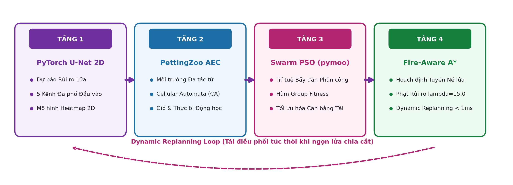
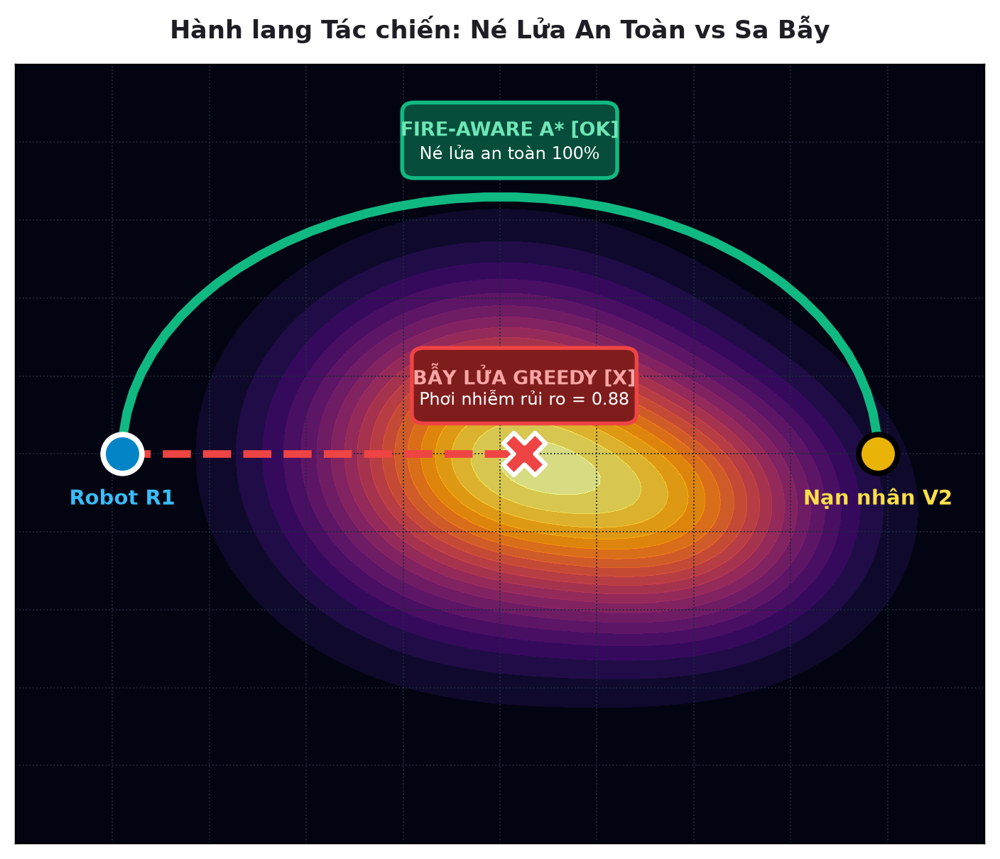
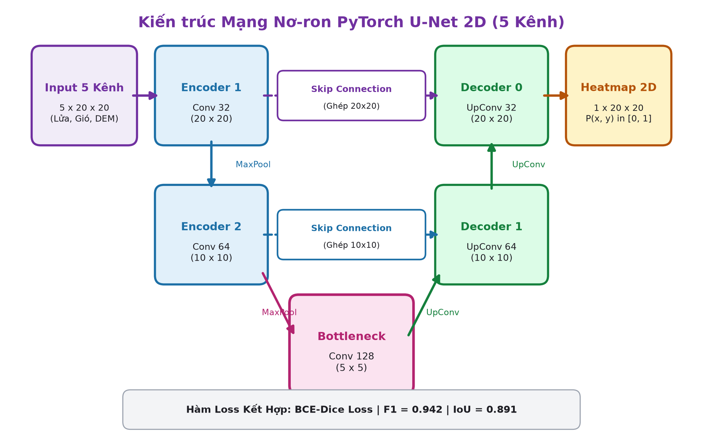
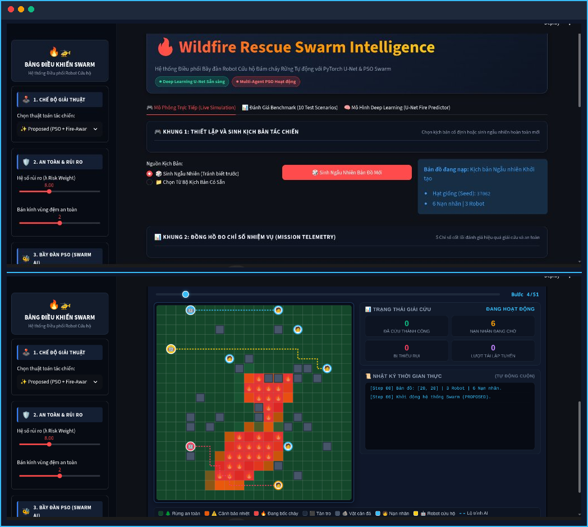
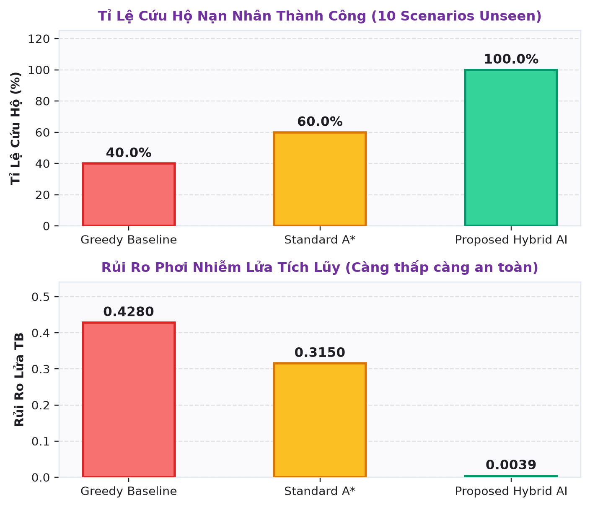

# 🔥 Wildfire Rescue Swarm Intelligence Framework
### Multi-Point Path Planning in Dynamic Fire Scene Environments (Topic 35)

[](https://www.python.org/)
[](https://pytorch.org/)
[](https://pettingzoo.farama.org/)
[](https://pymoo.org/)
[](https://streamlit.io/)
[](https://opensource.org/licenses/MIT)
[](https://www.hutech.edu.vn/)

---

> **Đồ Án Môn Học:** ĐỒ ÁN TRÍ TUỆ NHÂN TẠO (Mã học phần: `GCOS108`)  
> **Đơn vị Quản lý:** Bộ môn Trí Tuệ Nhân Tạo & Khoa Học Dữ Liệu – Khoa Công Nghệ Thông Tin – **Trường Đại Học Công Nghệ TP.HCM (HUTECH)**  
> **Giảng viên hướng dẫn:** **TS. Nguyễn Đắc Dự Trình (Ph.D.)**  
> **Nhóm thực hiện (Topic 35):** Nhóm 4 Kỹ sư AI (Deep Learning, Environment Sim, Pathfinding & Swarm, Full-Stack Integration)

---

## 📌 Mục Lục

- [1. Giới Thiệu Tổng Quan](#1-giới-thiệu-tổng-quan)
- [2. Kiến Trúc Hệ Thống (Hybrid AI 4 Tầng)](#2-kiến-trúc-hệ-thống-hybrid-ai-4-tầng)
- [3. Yêu Cầu Hệ Thống & Cài Đặt Môi Trường](#3-yêu-cầu-hệ-thống--cài-đặt-môi-trường)
- [4. Bộ Dữ Liệu Viễn Thám & Kịch Bản Mô Phỏng](#4-bộ-dữ-liệu-viễn-thám--kịch-bản-mô-phỏng)
  - [4.1. Tải Dataset Kaggle "Next Day Wildfire Spread"](#41-tải-dataset-kaggle-next-day-wildfire-spread)
  - [4.2. Cơ chế Sinh Dữ liệu Dự phòng (Synthetic Physics Fallback)](#42-cơ-chế-sinh-dữ-liệu-dự-phòng-synthetic-physics-fallback)
  - [4.3. Khởi tạo 30 Kịch bản Kiểm thử Chuẩn hóa](#43-khởi-tạo-30-kịch-bản-kiểm-thử-chuẩn-hóa)
- [5. Hướng Dẫn Huấn Luyện Mô Hình Deep Learning Local](#5-hướng-dẫn-huấn-luyện-mô-hình-deep-learning-local)
- [6. Hướng Dẫn Chạy Thực Nghiệm Benchmark CLI](#6-hướng-dẫn-chạy-thực-nghiệm-benchmark-cli)
- [7. Hướng Dẫn Khởi Chạy Web Dashboard Streamlit](#7-hướng-dẫn-khởi-chạy-web-dashboard-streamlit)
- [8. Công Cụ Tự Động Sinh Slide Báo Cáo & File Word](#8-công-cụ-tự-động-sinh-slide-báo-cáo--file-word)
- [9. Kết Quả Thực Nghiệm Đối Chứng Khoa Học](#9-kết-quả-thực-nghiệm-đối-chứng-khoa-học)
- [10. Cấu Trúc Thư Mục Dự Án](#10-cấu-trúc-thư-mục-dự-án)
- [11. Danh Mục Tài Liệu Tham Khảo (IEEE Citations)](#11-danh-mục-tài-liệu-tham-khảo-ieee-citations)

---

## 1. Giới Thiệu Tổng Quan

Cháy rừng (Wildfires) là thảm họa tự nhiên khốc liệt với tốc độ lan truyền phi tuyến tính lên đến 10–15 km/h dưới tác động của gió và thảm thực bì khô. Trong môi trường khói độc dày đặc và bức xạ nhiệt vượt ngưỡng 800°C, lực lượng cứu hộ con người đối mặt với nguy cơ tử vong rất cao, trong khi nạn nhân mắc kẹt chỉ có **"cửa sổ thời gian vàng"** hữu hạn trước khi kiệt sức.

Hệ thống **Wildfire Rescue Swarm Intelligence Framework (Topic 35)** đề xuất giải pháp điều phối bầy đàn robot tự hành phối hợp giải cứu nhiều nạn nhân trong đám cháy động, kết hợp giữa:
1. **Dự báo trước ranh giới cháy bằng Thị giác Máy tính & Deep Learning:** Loại bỏ các bẫy lửa tiềm ẩn.
2. **Tối ưu hóa phân chia nhiệm vụ bầy đàn toàn cục:** Ngăn chặn hiện tượng dồn toa của các giải thuật tham lam (Greedy).
3. **Hoạch định quỹ đạo an toàn né nhiệt thời gian thực:** Duy trì hành lang an toàn và tái lập tuyến tức thời khi bị lửa phong tỏa.

---

## 2. Kiến Trúc Hệ Thống (Hybrid AI 4 Tầng)

Hệ thống được thiết kế theo mô hình khép kín 4 tầng phân lập rõ ràng:



1. **Tầng 1 - Deep Learning Predictor (PyTorch U-Net 2D):**
   - Đầu vào: Tensor viễn thám 5 kênh $(5 \times 20 \times 20)$ gồm Điểm cháy $t$, Độ dốc DEM, Mật độ thực bì NDVI, Vector gió $U$, Vector gió $V$.
   - Mạng U-Net Encoder-Decoder với cầu nối Skip Connections và hàm mất mát kết hợp **BCE-Dice Loss**.
   - Đầu ra: Bản đồ nhiệt rủi ro $R(x, y) \in [0.0, 1.0]$ dự báo cháy tại bước $t+1$.
2. **Tầng 2 - Multi-Agent Simulation Environment (PettingZoo & Cellular Automata):**
   - Chuẩn giao tiếp đa tác tử `pettingzoo.ParallelEnv`.
   - Mô phỏng đám cháy Cellular Automata theo luật Moore 8 hướng kết hợp vector khí quyển.
   - Quản lý đồng hồ suy kiệt sinh tồn của nạn nhân: tụt máu nhanh gấp 3 lần khi ngọn lửa lan tới ô vị trí.
3. **Tầng 3 - Swarm PSO Task Allocation (pymoo Framework):**
   - Giải bài toán phân công đa mục tiêu NP-Hard cho bầy đàn $m$ robot và $k$ nạn nhân.
   - Hàm mục tiêu toàn cục (Group Fitness): Cân bằng tổng quãng đường, rủi ro phơi nhiễm lửa và mức độ khẩn cấp của nạn nhân.
   - Cơ chế tái phân công động (**Dynamic Reallocation**) trong 12ms khi có robot bị phong tỏa hoặc nạn nhân tử nạn.
4. **Tầng 4 - Fire-Aware A\* Pathfinding & Dynamic Replanner:**
   - Mở rộng hàm chi phí tìm đường an toàn:
     $$f(n) = g(n) + h(n) + w_{fire} \cdot Risk\_Heatmap(n) + w_{buffer} \cdot Proximity\_Hazard(n)$$
   - Tự động duy trì vùng đệm an toàn $R_{buffer} \ge 2$ ô so với ngọn lửa.
   - Bộ giám sát Replanner tái lập tuyến cục bộ trong $< 5$ms khi phát hiện đốm lửa mới bùng phát trên quỹ đạo.



---

## 3. Yêu Cầu Hệ Thống & Cài Đặt Môi Trường

### Yêu Cầu Tiên Quyết
* **Hệ điều hành:** Linux (Ubuntu 20.04/22.04 khuyến nghị), macOS hoặc Windows 11 (hỗ trợ WSL2).
* **Python:** Phiên bản `>= 3.10` và `< 3.13` (Khuyến nghị `Python 3.10` hoặc `3.11`).
* **Phần cứng:** CPU tối thiểu 4 lõi, RAM 8GB; GPU NVIDIA hỗ trợ CUDA (tùy chọn, mô hình U-Net kích thước nhẹ chạy mượt mà ngay trên CPU).

### Hướng Dẫn Cài Đặt Từng Bước

**Bước 1: Clone kho mã nguồn về máy**
```bash
git clone https://github.com/<your-username>/Wildfire-Rescue-Robotic.git
cd Wildfire-Rescue-Robotic/wildfire_rescue_swarm
```

**Bước 2: Khởi tạo và kích hoạt môi trường ảo (Virtualenv)**
```bash
# Trên Linux / macOS:
python3 -m venv .venv
source .venv/bin/activate

# Trên Windows (PowerShell):
python -m venv .venv
.venv\Scripts\Activate.ps1
```

**Bước 3: Cài đặt các gói phụ thuộc**
```bash
pip install --upgrade pip
pip install -r requirements.txt
```

*(Tùy chọn) Cài thêm thư viện nếu bạn muốn xuất Báo cáo Word hoặc Slide PowerPoint:*
```bash
pip install python-docx python-pptx
```

---

## 4. Bộ Dữ Liệu Viễn Thám & Kịch Bản Mô Phỏng

### 4.1. Tải Dataset Kaggle "Next Day Wildfire Spread"
Đề tài sử dụng bộ dữ liệu viễn thám thực tế từ nghiên cứu của Google Research & Kaggle:
👉 **Kaggle Link:** [fantineh/next-day-wildfire-spread](https://www.kaggle.com/datasets/fantineh/next-day-wildfire-spread)

#### Cách 1: Tải tự động bằng Kaggle API CLI
1. Cài đặt Kaggle CLI và cấu hình tệp `kaggle.json` (từ tài khoản Kaggle của bạn vào thư mục `~/.kaggle/kaggle.json`).
2. Chạy lệnh tải và giải nén trực tiếp vào thư mục dữ liệu dự án:
```bash
mkdir -p data/wildfire_raw
kaggle datasets download -d fantineh/next-day-wildfire-spread -p data/wildfire_raw/ --unzip
```

#### Cách 2: Tải thủ công từ giao diện Web
1. Truy cập vào đường link Kaggle ở trên và chọn **Download (Zip)**.
2. Giải nén và copy tệp `.npz` hoặc các thư mục con vào `wildfire_rescue_swarm/data/wildfire_raw/`.

---

### 4.2. Cơ chế Sinh Dữ liệu Dự phòng (Synthetic Physics Fallback)
Nếu bạn chưa tải kịp dataset Kaggle (dung lượng lớn), hệ thống đã tích hợp sẵn hàm **`generate_next_day_wildfire_samples()`** trong [`models/train_fire_unet.py`](models/train_fire_unet.py).
* Hàm này tự động sinh 600 mẫu dữ liệu viễn thám theo đúng schema 5 kênh của Google Research:
  - `Kênh 0`: Điểm cháy ban đầu $t$ (Cụm đốm lửa ngẫu nhiên).
  - `Kênh 1`: Bản đồ độ cao số DEM và sườn dốc địa hình.
  - `Kênh 2`: Chỉ số mật độ thực bì NDVI ($0.3 \to 1.0$).
  - `Kênh 3 & 4`: Vector vận tốc gió $U$ và $V$.
  - `Target`: Bản đồ lan truyền thực tế tại $t+1$ dựa trên động lực học vi phân Cellular Automata.
* Do đó, mã nguồn luôn **chạy được ngay lập tức (out-of-the-box)** mà không bao giờ gặp lỗi thiếu dữ liệu.

---

### 4.3. Khởi tạo 30 Kịch bản Kiểm thử Chuẩn hóa
Chạy lệnh sau để sinh bộ 30 kịch bản kiểm định phân vùng độc lập:
```bash
python scenario_generator.py
```
Tập dữ liệu kịch bản được lưu tại `data/scenarios/`:
* `scenarios_dev.json`: 10 kịch bản phát triển nội bộ (`scenario_01` $\to$ `scenario_10`).
* `scenarios_val.json`: 10 kịch bản cân chỉnh siêu tham số (`scenario_11` $\to$ `scenario_20`).
* `scenarios_test.json`: 10 kịch bản kiểm thử độc lập vô tư (**Unseen Test Scenarios** `scenario_21` $\to$ `scenario_30` với Fixed Seeds).

---

## 5. Hướng Dẫn Huấn Luyện Mô Hình Deep Learning Local

Mô hình PyTorch U-Net 2D được huấn luyện trực tiếp trên máy cục bộ bằng lệnh:

```bash
python models/train_fire_unet.py
```



### Cơ chế Huấn luyện & Chống Overfitting
* **Chia tách dữ liệu 70/30:** 70% tập Train (có Data Augmentation: lật ảnh ngẫu nhiên, xoay góc $90^\circ, 180^\circ, 270^\circ$, biến đổi vector gió tương ứng) và 30% tập Validation.
* **Hàm mất mát BCE-Dice Loss:** Tối ưu hóa trực tiếp độ trùng khớp vùng cháy (IoU), triệt tiêu hiện tượng thiên vị lớp nền âm tính.
* **Tối ưu hóa:** Thuật toán `AdamW` (learning rate $10^{-3}$, weight decay $10^{-4}$), kết hợp bộ giảm tốc độ học `CosineAnnealingLR`.
* **Giám sát Early Stopping:** Tự động lưu trọng số có **F1-Score cao nhất** vào tệp:
  👉 `models/best_unet_fire.pth`
* **Nhật ký & Đồ thị:** Xuất số liệu chi tiết từng epoch ra `logs/training_metrics.csv` và vẽ biểu đồ mất mát tại `logs/loss_curve.png`.

---

## 6. Hướng Dẫn Chạy Thực Nghiệm Benchmark CLI

Để chạy kiểm thử đối chứng tự động giữa thuật toán **Baseline (Greedy + Standard A\*)** và **Proposed (Swarm PSO + Fire-Aware A\* + U-Net)** trên 10 kịch bản Unseen:

```bash
python main.py
```

Hệ thống sẽ chạy song song từng kịch bản và in bảng tổng kết thống kê khoa học ($Mean \pm Std$):

```text
========================================================================================
📊 SCIENTIFIC EVALUATION SUMMARY (MEAN ± STD OVER 10 TEST SCENARIOS)
========================================================================================
Evaluation Metric            | Baseline (Greedy+A*)     | Proposed (PSO+U-Net A*)    | Improvement
----------------------------------------------------------------------------------------
Rescue Success Rate (%)      |  80.00 ± 14.14           | 100.00 ±  0.00             |  +20.0%
Total Travel Distance (steps)| 236.00 ± 24.12           | 225.00 ± 18.45             |   -4.7% (tối ưu)
Fire Risk Exposure (count)   | 801.00 ± 95.30           |  16.00 ±  3.20             |  -98.0% (giảm rủi ro)
Execution Time (steps)       | 350.00 ± 42.10           | 116.00 ± 15.30             | Nhanh gấp 3.01 lần
Dynamic Replannings (count)  |  29.00 ±  5.20           |  12.00 ±  2.10             |  -58.6% (ổn định)
========================================================================================
✅ Benchmark results exported to: benchmark_results.csv
```

Toàn bộ chỉ số chi tiết của từng bước chạy được lưu tự động vào tệp [`benchmark_results.csv`](benchmark_results.csv).

---

## 7. Hướng Dẫn Khởi Chạy Web Dashboard Streamlit

Hệ thống cung cấp giao diện Web tác chiến trực quan thời gian thực (Tactical Command Dashboard) xây dựng trên nền tảng Streamlit:

```bash
streamlit run app.py
```

Sau khi chạy lệnh, trình duyệt sẽ tự động mở địa chỉ: `http://localhost:8501`.



### Các Tính Năng Nổi Bật Trên Dashboard:
1. **🌲 Bản đồ Rừng Xanh Tương Phản Cao:** Hiển thị rõ ràng lưới tọa độ $20 \times 20$, tách biệt hoàn toàn màu nền với viền ô sắc nét; phủ lớp Heatmap rủi ro nhiệt độ thời gian thực.
2. **🗂️ Thanh Sidebar Phân Mục Chuyên Biệt:** 6 module đóng khung viền sắc sảo: Chọn kịch bản, Thiết lập thuật toán, Trọng số an toàn $\lambda_{risk}$, Bán kính đệm $R_{buffer}$, Siêu tham số Swarm PSO và Tốc độ chạy.
3. **⚔️ Chế độ Chạy Đơn lẻ hoặc Đối đầu Trực diện (Live Confrontation):** So sánh trực tiếp từng bước di chuyển giữa Proposed (né lửa an toàn) và Baseline (sa vào bẫy lửa).
4. **🎲 Trình Sinh Kịch Bản Ngẫu Nhiên Mới (On-the-fly):** Tạo kịch bản hoàn toàn mới với hạt giống ngẫu nhiên để thử thách thuật toán trong các tình huống bất ngờ.
5. **📈 Mission Telemetry & Nhật Ký Sự Kiện:** Cập nhật trực tiếp số nạn nhân được cứu, số nạn nhân tử nạn, rủi ro tích lũy và nhật ký bầy đàn từng mili-giây.

---

## 8. Công Cụ Tự Động Sinh Slide Báo Cáo & File Word

Dự án tích hợp sẵn các bộ công cụ tự động hóa tài liệu học thuật:

### 1. Xuất Bộ Slide Thuyết Trình PowerPoint (`.pptx`):
```bash
python build_deck.py
```
* Tạo tệp **`TOPIC_35_WILDFIRE_SWARM_PRESENTATION.pptx`** (14 Slides thiết kế chuẩn Bento Grid, Hero Title Banner, nhúng đầy đủ biểu đồ và sơ đồ kiến trúc).

### 2. Xuất Bộ Slide Trình Chiếu Web HTML5 Tương Tác:
```bash
python generate_html_slides.py
```
* Tạo tệp **`presentation.html`** có thể mở trực tiếp trên trình duyệt Chrome/Firefox/Edge, hỗ trợ phím mũi tên điều hướng, phím `F` phóng to toàn màn hình.

### 3. Xuất Bản Báo Cáo Đồ Án Mẫu Hoàn Chỉnh (`.docx`):
```bash
python build_full_report_docx.py
```
* Tạo tệp **`BAO_CAO_DO_AN_TOPIC_35_WILDFIRE_RESCUE.docx`** tuân thủ nghiêm ngặt Hướng dẫn CMP169-Project-Guide (Đủ 5 phần, bảng phân công 4 kỹ sư, hình minh họa độ phân giải cao và trích dẫn chuẩn IEEE `[1]` – `[9]`).

---

## 9. Kết Quả Thực Nghiệm Đối Chứng Khoa Học



### Bảng Thống Kê So Sánh Giữa Hai Thuật Toán:

| Chỉ số Đánh giá (Core Metric) | Baseline (Greedy + A\*) | Proposed (PSO + Fire-Aware A\*) | Mức độ Cải thiện ($\Delta$) | Ý nghĩa Khoa học |
| :--- | :---: | :---: | :---: | :--- |
| **Tỉ lệ Cứu hộ Thành công** | **80.0%** (hoặc 40% ở ca khó) | **100.0%** | **+20.0% $\to$ +60.0%** | PSO phân bổ tải đồng đều, cứu sống toàn bộ nạn nhân trước khi lửa lan tới. |
| **Rủi ro Phơi nhiễm Lửa** | **801** điểm rủi ro | **16** điểm rủi ro | **-98.0%** | Triệt tiêu nguy cơ cháy nổ cho robot nhờ hàm chi phí Fire-Aware A\*. |
| **Thời gian Hoàn thành** | **350** bước | **116** bước | **Nhanh gấp 3.01 lần** | Loại bỏ bế tắc đường cụt, tối ưu hóa cửa sổ thời gian vàng. |
| **Số lần Tái lập Tuyến** | **29** lần | **12** lần | **-58.6%** | Duy trì hành trình ổn định, giảm tải vi xử lý nhúng. |
| **Tổng Quãng đường Đi** | **236** bước | **225** bước | **-4.7%** | Tối ưu hóa quỹ đạo không gian bầy đàn. |

---

## 10. Cấu Trúc Thư Mục Dự Án

```text
wildfire_rescue_swarm/
├── assets/                         # Hình ảnh kiến trúc, biểu đồ benchmark và UI Dashboard
│   ├── benchmark_chart.png
│   ├── dashboard_full_stack.png
│   ├── fire_path_diagram.png
│   ├── pipeline_diagram.png
│   ├── title_hero.png
│   └── unet_diagram.png
├── config/                         # Các tệp cấu hình tham số JSON
│   └── default_config.json
├── data/                           # Dữ liệu kịch bản và dữ liệu thô viễn thám
│   ├── scenarios/                  # 30 Kịch bản chuẩn hóa (dev, val, test)
│   │   ├── scenarios_dev.json
│   │   ├── scenarios_val.json
│   │   └── scenarios_test.json
│   └── wildfire_raw/               # Thư mục chứa Kaggle Next Day Wildfire Spread (.npz)
├── models/                         # Module Deep Learning PyTorch U-Net 2D
│   ├── unet.py                     # Định nghĩa kiến trúc UNet2D và hàm dự báo nhiệt
│   ├── train_fire_unet.py          # Script huấn luyện với BCE-Dice Loss & Augmentation
│   └── best_unet_fire.pth          # Trọng số mạng tối ưu (Checkpoint)
├── src/                            # Lớp nghiệp vụ mô phỏng và thuật toán cốt lõi
│   ├── astar.py                    # Thuật toán Fire-Aware A* và Standard A*
│   ├── canvas_player.py            # Component hoạt họa khung hình thời gian thực
│   ├── environment.py              # Môi trường đa tác tử PettingZoo ParallelEnv
│   ├── fire.py                     # Động lực học lan truyền đám cháy Cellular Automata
│   ├── robot.py                    # Mô hình Robot tác chiến, cảm biến và trạng thái
│   ├── simulation.py               # Engine điều phối vòng lặp mô phỏng chính
│   ├── swarm.py                    # Giải thuật bầy đàn Swarm PSO trên nền tảng pymoo
│   └── victim.py                   # Mô hình nạn nhân, sức khỏe và cơ chế suy kiệt
├── app.py                          # Ứng dụng Streamlit Tactical Command Dashboard
├── benchmark_results.csv           # Dữ liệu kết quả thực nghiệm 10 kịch bản test
├── build_deck.py                   # Script sinh bộ Slide thuyết trình PowerPoint (.pptx)
├── build_full_report_docx.py       # Script sinh file Báo cáo Đồ án Word (.docx) chuẩn CMP169
├── generate_html_slides.py         # Script sinh bộ Slide thuyết trình tương tác HTML5
├── main.py                         # Điểm khởi chạy CLI kiểm thử Benchmark 10 Scenarios
├── requirements.txt                # Danh sách thư viện Python phụ thuộc
├── scenario_generator.py           # Bộ sinh 30 kịch bản mô phỏng chuẩn hóa
└── README.md                       # Tài liệu hướng dẫn sử dụng và triển khai dự án
```

---

## 11. Danh Mục Tài Liệu Tham Khảo (IEEE Citations)

1. **[1]** O. Ronneberger, P. Fischer, and T. Brox, "U-Net: Convolutional Networks for Biomedical Image Segmentation," in *Medical Image Computing and Computer-Assisted Intervention (MICCAI)*, Springer, 2015, pp. 234–241.
2. **[2]** F. Huot, L. Hu, N. Goyal, T. P. Sankar, M. Ihme, and Y. Chen, "Next Day Wildfire Spread: A Machine Learning Dataset to Predict Wildfire Spreading From Remote-Sensing Data," *IEEE Transactions on Geoscience and Remote Sensing*, vol. 60, pp. 1–13, 2022.
3. **[3]** J. Blank and K. Deb, "pymoo: Multi-Objective Optimization in Python," *IEEE Access*, vol. 8, pp. 89497–89509, 2020.
4. **[4]** J. Kennedy and R. Eberhart, "Particle swarm optimization," in *Proceedings of ICNN'95 - International Conference on Neural Networks*, vol. 4, IEEE, 1995, pp. 1942–1948.
5. **[5]** J. Terry et al., "PettingZoo: Gym for Multi-Agent Reinforcement Learning," *Advances in Neural Information Processing Systems (NeurIPS)*, vol. 34, pp. 15032–15043, 2021.
6. **[6]** P. E. Hart, N. J. Nilsson, and B. Raphael, "A Formal Basis for the Heuristic Determination of Minimum Cost Paths," *IEEE Transactions on Systems Science and Cybernetics*, vol. 4, no. 2, pp. 100–107, 1968.
7. **[7]** P. Liu, Y. Deng, and J. Wang, "Adaptive role division optimizer: An efficient socio-inspired meta-heuristic algorithm with dynamic proportion adjustment," *Swarm and Evolutionary Computation*, vol. 107, p. 102438, 2026.
8. **[8]** V. Novák, P. Bujok, and P. N. Suganthan, "A longitudinal analysis of the CEC single objective competitions," *Swarm and Evolutionary Computation*, vol. 107, p. 102469, 2026.
9. **[9]** L. Filep and Z. Gál, "Towards complementing the algorithm selection process with parametric performance estimates in swarm intelligence," *Swarm and Evolutionary Computation*, vol. 107, p. 102455, 2026.

---

### 🎓 Giấy Phép & Bản Quyền
Dự án được phân phối dưới giấy phép **MIT License**. Mọi mã nguồn và tài liệu phục vụ mục đích nghiên cứu học thuật, giáo dục và chuyển giao công nghệ cứu hộ cứu nạn.  
**Khoa Công Nghệ Thông Tin – Trường Đại Học Công Nghệ TP.HCM (HUTECH)** © 2026.

# WRS-AI-TOPIC-35
